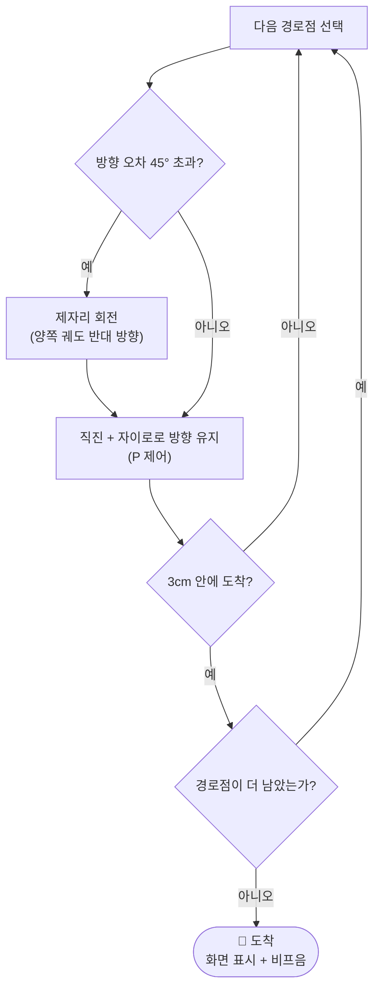

<div align="center">

# 📱 EV3 스마트폰 리모컨

**지도에서 강의실을 터치하면 로봇이 알아서 찾아가는 Python 버전 안내 로봇**

휴대폰 브라우저 하나로 호실 선택 · 조이스틱 조종 · 속도 조절까지


</div>

---

## 📑 목차

- [프로젝트 소개](#-프로젝트-소개)
- [EV3 Classroom 버전과 달라진 점](#-ev3-classroom-버전과-달라진-점)
- [주요 기능](#-주요-기능)
- [하드웨어 구성](#-하드웨어-구성)
- [준비물](#-준비물)
- [설치 방법](#-설치-방법)
- [처음 실행할 때](#-처음-실행할-때)
- [동작 원리](#-동작-원리)
- [설정값](#-설정값)
- [API](#-api)
- [문제 해결](#-문제-해결)
- [저장소 구조](#-저장소-구조)

---

## 📌 프로젝트 소개

기존 **EV3 Classroom(블록 코딩)** 으로 만들었던 강의실 안내 로봇을 **Python으로 다시 만든 프로젝트**입니다. 이 프로젝트는 AI(Claude)의 도움을 받아 작성했습니다.

로봇이 작은 **웹 서버**를 실행하고, 휴대폰은 일반 브라우저로 그 주소에 접속해 로봇을 제어합니다. 휴대폰에 앱을 설치할 필요가 없습니다.


페이지에는 세 개의 탭이 있습니다.

| 탭 | 하는 일 |
| --- | --- |
| **강의실** | 직접 그린 지도 위에 로봇의 현재 위치와 강의실을 표시합니다. 지도에서 강의실을 누르거나 호실 번호 버튼을 누르면, 로봇이 **현재 위치에서 복도를 따라 길을 찾아** 이동합니다. |
| **조이스틱** | 손가락으로 로봇을 직접 조종합니다. 조종 중에도 지도 위 위치가 계속 갱신됩니다. |
| **설정** | 지도 이미지 업로드, 거리 보정, 동작 설정을 합니다. |

**속도 슬라이더**와 빨간 **정지 버튼**은 모든 탭에서 항상 보입니다.

## 🔄 EV3 Classroom 버전과 달라진 점

| | EV3 Classroom 버전 | Python 버전 (이 저장소) |
| --- | --- | --- |
| 경로 | 호실별로 코드에 고정 (`FOLLOW` · `LEFT` · `RIGHT` · `DRIVE`) | 지도 위 **복도 선**에서 최단 경로를 자동 계산 |
| 호실 선택 | EV3 브릭 버튼 | 휴대폰 지도 터치 또는 호실 버튼 |
| 위치 파악 | 노란 스티커를 만나면 다음 명령 실행 | 모터 회전량 + 자이로로 **위치를 계속 추정**, 노란 스티커로 보정 |
| 수동 조종 | 없음 | 조이스틱 |
| 호실 추가 | 블록 코드 수정 | 지도에서 터치로 추가 |
| 실행 환경 | EV3 Classroom 앱 (기본 펌웨어) | ev3dev (microSD) |

기존 버전의 안전 기능(장애물 정지, 터치 센서 비상정지, 노란 스티커 활용)은 그대로 가져왔습니다.

## ✨ 주요 기능

- 📍 **지도 기반 길 찾기**: 복도 점과 선을 이은 지도에서 최단 경로를 계산해 이동
- 🎮 **조이스틱 조종**: 연결이 0.6초 이상 끊기면 로봇이 스스로 정지
- 🧭 **위치 추정**: 모터 회전량(주행 거리) + 자이로(방향)로 지도 위 위치를 계산
- 🟡 **스티커 보정**: 노란 스티커를 지나갈 때 위치 오차를 바로잡음
- 🚧 **장애물 대기**: 15cm 안에 장애물이 있으면 멈췄다가, 사라지면 이어서 주행
- 🛑 **터치 센서**: 누르면 정지 후 180° 회전 (설정에서 "정지만"으로 변경 가능)
- 🧪 **시뮬레이터**: 로봇 없이 컴퓨터에서 휴대폰 페이지를 테스트
- 💾 **자동 저장**: 설정은 `settings.json`, 지도는 `map.json`에 저장

## 🔌 하드웨어 구성

EV3 Classroom 프로젝트와 같은 구성입니다.

| 포트 | 연결 | 역할 |
| :---: | --- | --- |
| B, D | 모터 (무한궤도) | 주행 |
| 1 | 초음파 센서 | 15cm 안에 장애물이 있으면 대기 |
| 2 | 터치 센서 | 정지 후 180° 회전 |
| 3 | 컬러 센서 (바닥 향함) | 노란 스티커로 지도 위치 보정 |
| 4 | 자이로 센서 | 로봇이 바라보는 방향 (없으면 회전이 부정확) |

> 모터는 물리적으로 B가 오른쪽, D가 왼쪽이며 뒤집혀 장착되어 있어서 기본 설정이 `invert_motors: true`입니다.

## 🧰 준비물

1. **ev3dev가 설치된 microSD 카드**
   - 기본 LEGO 펌웨어에서는 Python 서버를 실행할 수 없습니다.
   - ev3dev.org에서 *ev3dev-stretch* 이미지를 받아 Etcher로 카드에 쓴 뒤 EV3에 꽂습니다.
   - 카드를 빼면 EV3는 원래대로 EV3 Classroom에서 사용할 수 있습니다.
   - 이미 "LEGO EV3 MicroPython" 카드가 있다면 그것도 ev3dev 기반이라 사용 가능합니다.
2. **휴대폰과의 연결** (둘 중 하나)
   - **USB Wi-Fi 어댑터** (권장): ev3dev.org의 호환 목록에 있는 어댑터를 꽂고, 휴대폰 핫스팟에 EV3를 연결합니다. (EV3 메뉴 *Wireless and Networks → Wi-Fi*)
   - **Bluetooth**: 휴대폰에서 블루투스 테더링을 켜고, EV3에서 *Wireless and Networks → Bluetooth → Network Connection*으로 연결합니다.

## 📦 설치 방법

1. `robot_server.py`와 `static` 폴더(안에 `index.html`)를 `ev3robot` 폴더로 묶어 EV3에 복사합니다.
   - VS Code의 *ev3dev-browser* 확장을 쓰는 것이 가장 쉽습니다.
   - 네트워크로는: `scp -r ev3robot robot@ev3dev.local:~/` (비밀번호 `maker`)
2. EV3에서 *File Browser → ev3robot → robot_server.py*를 열고 가운데 버튼을 누릅니다.
   - 실행되지 않으면 EV3에서 한 번 `chmod +x ~/ev3robot/robot_server.py`를 실행하세요.
3. 처음 **2초 동안은 로봇을 건드리지 마세요.** 자이로를 보정하는 시간입니다.
4. EV3 화면에 `Phone: http://192.168.43.57:8000` 같은 주소가 나타나면, 휴대폰 브라우저에서 그 주소를 엽니다.

**로봇 없이 테스트하려면** 컴퓨터에서 아래처럼 실행하고 `http://localhost:8000`을 엽니다. 이 모드에서는 가상 로봇이 움직입니다.

```bash
python3 robot_server.py --sim
```

포트를 바꾸려면 `--port 9000`처럼 지정합니다.

## 🚀 처음 실행할 때

순서대로 진행하세요.

1. **거리 보정** (*설정*)
   "3바퀴 주행"을 누르고, 줄자로 실제 이동 거리를 재서 입력한 뒤 저장합니다. 이 과정을 건너뛰면 이동 거리가 맞지 않습니다.
2. **방향 확인** (*조이스틱*)
   앞으로 밀면 로봇이 앞으로 가야 하고, 지도의 화살표도 로봇과 같은 방향으로 돌아야 합니다.
   - 로봇이 뒤로 가면 아래 [문제 해결](#-문제-해결)을 보세요.
   - 화살표만 반대로 돌면 *설정 → 자이로 → 반대로*를 선택하세요.
3. **지도 올리기** (*설정*)
   손으로 그린 지도를 **바로 위에서** 촬영해 업로드하고, 지도의 **실제 가로 길이(cm)** 를 입력한 뒤 "지도 저장"을 누릅니다.
4. **지도 편집** (*강의실* 탭 → "지도 편집", 한 번만 하면 됩니다)
   - **복도**: 복도 중앙에 점을 찍습니다. 새 점은 직전 점과 선으로 이어집니다. 갈림길을 만들려면 이미 찍은 점을 눌러 거기서부터 이어가고, "새 선 시작"으로 따로 선을 시작할 수 있습니다. 로봇은 **이 선 위로만** 다니므로 벽이 없는 곳에 그리세요.
   - **강의실**: 강의실 문 앞을 눌러 번호(301, 302, 303 …)를 입력합니다. 다시 누르면 이름을 바꿀 수 있습니다.
   - **스티커**: 바닥의 노란 스티커 위치를 모두 표시합니다. 로봇이 스티커를 지나면서 자기 위치를 바로잡습니다.
   - **삭제**: 강의실, 복도 점, 스티커를 누르면 삭제됩니다.
   - 끝나면 "완료"를 누릅니다.
5. **로봇 위치 지정**
   "로봇 위치 지정"을 누르고, 지도에서 로봇이 있는 곳을 누른 채로 로봇이 바라보는 방향으로 손가락을 끌어 줍니다. 전원을 켤 때마다, 로봇이 마지막 정지 위치가 아닌 곳에 있다면 해 주세요.
6. **출발**
   지도에서 강의실을 누르고 "출발"을 확인하거나, 아래의 호실 번호 버튼을 누릅니다. 이동 중에 다른 강의실을 선택하면, 로봇이 현재 위치에서 새 목적지로 방향을 바꿉니다.

## 🧠 동작 원리

### 위치 추정 (오도메트리)

- 모터 회전량으로 **얼마나 갔는지**, 자이로로 **어느 쪽을 보는지**를 계산해 지도 위 좌표 `(x, y)`와 방향을 갱신합니다.
- 오차가 조금씩 쌓이므로, **노란 스티커를 3회 연속 감지**하면 지도에 표시된 가장 가까운 스티커(반경 40cm 이내)로 위치를 교정합니다.
- 자이로가 없으면 양쪽 바퀴의 회전 차이로 방향을 추정합니다. (이 경우 회전이 덜 정확합니다.)

### 길 찾기

1. 로봇은 가장 가까운 복도 선 위의 점으로 들어갑니다.
2. 복도 점들 사이의 **최단 경로**를 구합니다. (Floyd–Warshall 알고리즘, 작은 지도용)
3. 목적지에서 가장 가까운 복도 선에서 나와 강의실 문 앞으로 갑니다.
4. 복도 점이 서로 이어져 있지 않으면 "점들이 연결되지 않았다"는 오류를 돌려줍니다.

### 경로 주행



- 마지막 점이 15cm 안으로 가까워지면 속도를 줄여 부드럽게 멈춥니다.
- 제어 루프는 **50Hz(0.02초)** 로 돌고, 센서 읽기 → 위치 갱신 → 주행 명령이 한 번에 처리됩니다.

### 안전 장치

| 상황 | 동작 |
| --- | --- |
| 장애물 15cm 이내 (경로 주행) | 정지하고 대기, 18cm 이상 벌어지고 0.5초가 지나면 이어서 주행 |
| 장애물 15cm 이내 (조이스틱) | 앞으로 가는 입력만 막고, 후진과 회전은 가능 |
| 터치 센서 | 정지 후 180° 회전 (또는 정지만) |
| 조이스틱 신호 0.6초 이상 없음 | 자동 정지 |
| 제어 루프 오류 | 모터 정지 후 대기 상태로 전환 |

> 장애물 정지(15cm)와 재출발(18cm) 기준을 다르게 둬서, 경계 거리에서 멈췄다 출발하기를 반복하는 떨림을 막습니다.

## 🔧 설정값

*설정* 탭에서 바꿀 수 있고 `settings.json`에 저장됩니다. (`settings.json`은 첫 저장 후에 생기며, EV3 위에서 VS Code로 직접 열어 고칠 수도 있습니다.)

| 항목 | 기본값 | 설명 |
| --- | :---: | --- |
| `speed` | 40 | 경로 주행 · 조이스틱 속도 (%) |
| `turn_speed` | 25 | 제자리 회전 속도 (%) |
| `heading_kp` | 1.5 | 경로에서 벗어났을 때 되돌아오는 세기 |
| `cm_per_rot` | 12.0 | 모터 1회전당 이동 거리 (cm), 보정 필요 |
| `track_width_cm` | 12.0 | 궤도 간격 (자이로가 없을 때만 사용) |
| `sensor_offset_cm` | 8.0 | 회전 중심에서 컬러 센서까지의 앞쪽 거리 |
| `obstacle_cm` / `clear_cm` | 15 / 18 | 장애물 정지 · 재출발 거리 |
| `snap_radius_cm` | 40 | 이 반경 안의 스티커로 위치를 보정 |
| `touch_action` | `turn180` | `turn180` 또는 `stop` |
| `gyro_sign` | 1 | 지도에서 회전 방향이 반대면 `-1` |
| `invert_motors` | `true` | 모터 "앞"이 실제로는 뒤일 때 사용 |
| `left_port` / `right_port` | `D` / `B` | 좌우 모터 포트 |

> 포트와 `invert_motors`를 바꾸면 프로그램을 다시 시작해야 적용됩니다.

## 🌐 API

휴대폰 페이지가 사용하는 HTTP API입니다. 직접 호출해서 다른 클라이언트를 만들 수도 있습니다.

| 메서드 | 경로 | 설명 |
| :---: | --- | --- |
| GET | `/api/state` | 위치, 방향, 모드, 경로, 센서 값 |
| GET | `/api/map` · `/api/settings` | 지도 · 설정 조회 |
| POST | `/api/joystick` | 조이스틱 값 `{x, y}` |
| POST | `/api/goto` | 호실로 이동 `{room}` |
| POST | `/api/path` | 직접 지정한 경로점으로 이동 `{points, append}` |
| POST | `/api/stop` | 정지 |
| POST | `/api/speed` | 속도 변경 `{speed}` |
| POST | `/api/pose` | 로봇 위치 지정 `{x, y, heading}` |
| POST | `/api/turn` | 제자리 회전 `{degrees}` |
| POST | `/api/testdrive` | 거리 보정용 주행 `{rotations}` |
| POST | `/api/map` · `/api/settings` | 지도 · 설정 저장 |
| POST | `/api/sim_obstacle` | 가상 장애물 만들기 (시뮬레이터 전용) |

## 🩺 문제 해결

| 증상 | 해결 방법 |
| --- | --- |
| 로봇이 뒤로 간다 | `settings.json`에서 `"invert_motors"` 값을 반대로 바꾸고 프로그램을 다시 시작 |
| 조이스틱 "오른쪽"이 왼쪽으로 돈다 | `settings.json`에서 `"left_port": "D"`와 `"right_port": "B"`를 서로 바꾸고 다시 시작 |
| 지도의 화살표가 반대로 돈다 | *설정 → 자이로 → 반대로* |
| 가야 할 거리보다 더 가거나 덜 간다 | 거리 보정을 다시 진행 |
| "복도 점이 연결되지 않았다" | *지도 편집 → 복도*에서 한 선의 점을 누르고 다른 선의 점을 눌러 하나의 망으로 연결 |
| 벽을 가로질러 간다 | 모퉁이에 복도 점을 추가해 선이 복도를 따라가게 함 |
| 회전이 부정확하다 | 자이로가 포트 4에 있는지, 시작할 때 로봇이 가만히 있었는지 확인 |
| 페이지가 열리지 않는다 | 휴대폰과 EV3가 같은 네트워크인지, EV3 화면의 주소가 맞는지 확인 |
| 노란 스티커를 못 찾는다 | 컬러 센서를 바닥에서 약 1cm 높이로 낮추고, 선명한 무광 노란색 스티커를 사용 |

## 📁 저장소 구조

```text
ev3robot/
├── robot_server.py     # 웹 서버 + 제어 루프 (위치 추정, 길 찾기, 주행, 안전 처리)
├── static/
│   └── index.html      # 휴대폰 제어 페이지 (강의실 · 조이스틱 · 설정)
├── settings.json       # 설정 저장 (첫 저장 후 자동 생성)
└── map.json            # 지도 · 강의실 · 복도 · 스티커 (저장 시 자동 생성)
```

- `robot_server.py`는 표준 라이브러리만 사용하고, EV3에서는 `ev3dev2`를 사용합니다.
- 컴퓨터에서는 `ev3dev2`가 없으면 자동으로 시뮬레이터로 동작합니다.

---

<div align="center">

**만든 사람** · 👑사일라우바예브아얀([@zvcwv](https://github.com/zvcwv)) - EV3 based code, EV3dev environment installation, GitHub
-  엄세르게이 ([@visyy](https://github.com/visyyy)) - Python based code, robot's logic, bug fixing
-  김민준 ([@beat-bit](https://github.com/beat-bit)) - robot build, robot testing
-  김주하 - 발표, video recording

</div>
